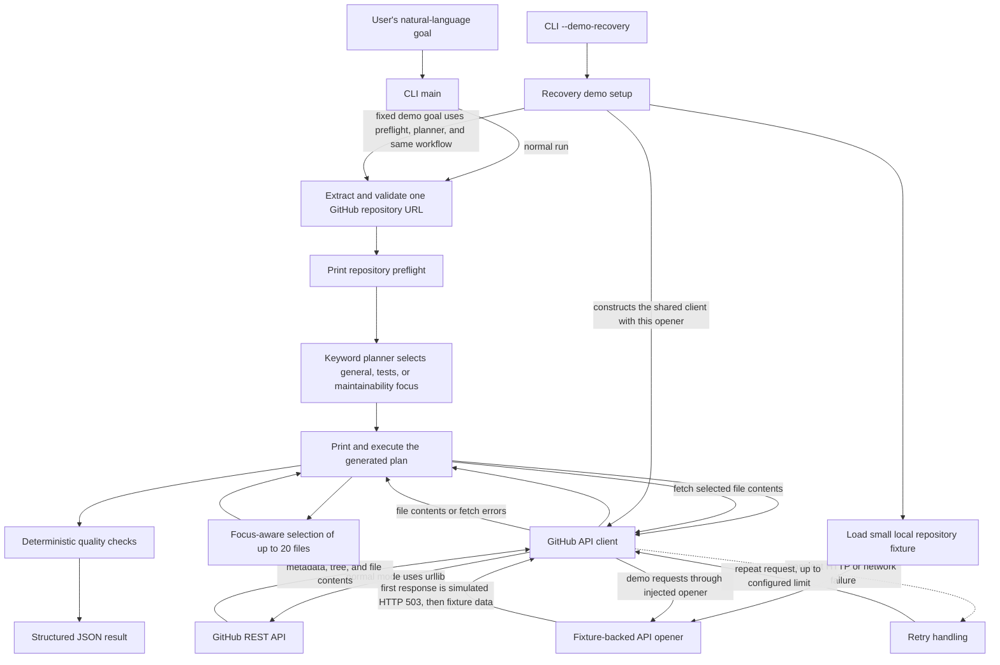

# Architecture

## Components and data flow

- The normal CLI accepts the user's goal. URL extraction requires exactly one HTTPS GitHub repository URL. After validation, the CLI prints the repository preflight and passes the original goal to the planner.
- The planner uses keyword rules to choose general, tests, or maintainability focus, with general as the fallback. It returns executable step identifiers and descriptions. The workflow prints that plan before API requests and follows its steps to fetch metadata and the recursive tree, select files, inspect content, and summarize findings.
- The GitHub API client uses `urllib` with a timeout. Its shared request method retries HTTP 429 and 5xx errors, plus URL and timeout failures, up to the configured retry limit. Permanent HTTP errors become `GitHubAPIError`.
- File selection keeps at most 20 focus-relevant paths while filtering common hidden, generated, and vendor paths. General focus prioritizes root README, manifests, and source files. Tests focus prioritizes test files and source files. Maintainability focus selects dependency manifests and non-test source files. The checks report missing README or obvious tests from the tree and scan fetched, reviewable contents for TODO/FIXME markers, broad `except Exception` handling, and long files. Fetch failures and oversized files are recorded as skipped.
- The JSON result reports complete or partial status, counts of requested and reviewed files, skipped paths and reasons, findings, and limitations.

## Recovery demonstration

`--demo-recovery` loads `fixtures/demo_repo.json` and supplies a fixture-backed opener to the same `GitHubAPI` client used for live requests. The opener raises a simulated HTTP 503 on its first request. The normal retry handler catches it, runs its configured retry callback, and calls the opener again. That retry and subsequent requests receive fixture responses. The demo then uses the same review workflow and checks as a normal run. The injected 503 is generated locally and is not a GitHub response.

The planner and checks are deterministic Python code. The plan focus depends on goal keywords, but the planner is limited to this review task and does not interpret arbitrary instructions. There is no LLM: findings come from explicit rules rather than model interpretation.
